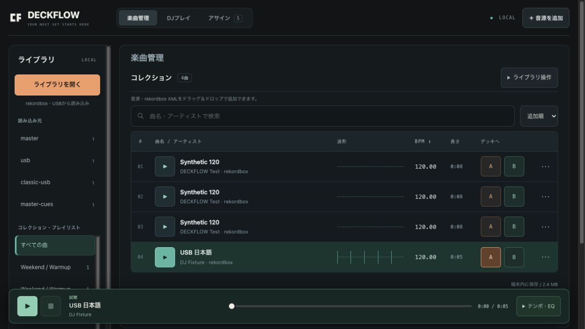

# DECKFLOW

本番アプリ: **[deckflow-five.vercel.app](https://deckflow-five.vercel.app/)** — iPadのSafariからアクセスできます。共有メニューから「ホーム画面に追加」でPWAとして利用できます。

**曲を整える。流れをつくる。**

手元の音源を整理・解析し、タッチでもMIDIでもプレイできるDJワークスペース。iPad miniで外に持ち出し、CDJ-3000用USBの準備につなげることを目指しています。

現在は **v0.1 開発版**のWebアプリ／PWAです。CDJ用データの生成にはMac補助ツールを組み合わせます。物理iPad・コントローラー・CDJでの実機検証はまだ完了していません。



## 動かす

Web版にnpm依存のインストールは不要です。Node.js 22以上を推奨します。

```sh
git clone https://github.com/bassmicrobe/DECKFLOW.git
cd DECKFLOW
npm run build
npm run dev
```

表示されたローカルURLを開くと、最初に**楽曲管理・解析**画面が表示されます。左側の「ライブラリを開く」から既存のrekordboxライブラリやUSBを選べます。音源ファイルのドラッグ＆ドロップ、「音源を追加」「デモ音源を試す」にも対応します。デモ2曲は端末内で合成するオリジナル音源です。再生は自動では始まりません。

Macのlocalhost URLを別端末のiPadから開くことはできません。iPadではHTTPS配信したWeb版を利用してください。

音源を追加 → BPMを確認 → 曲の **A / B** でデッキへ読み込み → 「DJプレイ」に切り替えて再生。プラッターは押さえて前後に回すとスクラッチし、離すと押さえる前の再生状態に戻ります。押さえる前が停止中なら停止状態を保ちます。

画面はウインドウの横幅いっぱいに広がり、デッキ・波形・プラッター・曲名欄が幅に応じて伸縮します。狭い画面では操作部を折り返し、iPad横向きではミキサーまで収まるコンパクト表示になります。ドラッグ＆ドロップを使えないタッチ環境では「音源を追加」からファイルを選択できます。

楽曲一覧の **▶** でその場で試聴できます。同じボタンで一時停止、試聴バーの **■** で停止して先頭に戻ります。下部の試聴バーから再生位置を変更でき、「テンポ・EQ」を開くと再生BPM（±50%）、LOW／MID／HIGHの3バンドEQ（−24〜＋12 dB）を調整できます。「解析BPMを修正」では保存する曲情報を編集します。試聴のテンポ変更は音程と連動し、別の曲の▶を押すと調整をリセットして切り替わります。DJプレイへ移ると試聴を停止します。DJデッキが再生中の場合は、デッキを停止してから試聴してください。試聴は端末の通常出力を使い、独立したヘッドホンCUEではありません。

## Dockerで起動する

Docker Engine／Docker DesktopとCompose v2以降で起動できます。Node.jsをホストへインストールする必要はありません。

```sh
docker compose up --build
```

[http://localhost:8080](http://localhost:8080) を開きます。バックグラウンド起動は `docker compose up --build -d`、停止は `docker compose down` です。ポートが使用中なら `DECKFLOW_PORT=8081 docker compose up --build` のように指定します。

ビルド用Node.jsと配信用nginxを分けた構成で、起動時は静的なWeb資産だけを配信します。コンテナは非root・読み取り専用で動き、音源やライブラリは引き続きブラウザ内のIndexedDBに保存されます。Docker用のデータボリュームは不要です。接続先のホスト名やポートを変えるとブラウザ上は別の保存領域になります。

初期設定はMac自身の `127.0.0.1` のみに公開します。iPadから利用する場合は、VercelなどのHTTPS配信を使うか、このコンテナの前にHTTPSのリバースプロキシを置いてください。LANへバインドする設定は `DECKFLOW_BIND=0.0.0.0` です。LANのHTTP URLだけではAudioWorkletやPWAなどが動作しないため、iPad利用にはHTTPSが必要です。

## Vercelにデプロイする

DECKFLOWはブラウザ側で音源処理・保存を行う静的アプリなので、Vercelへデプロイできます。リポジトリの `vercel.json` が `npm run build` と出力ディレクトリ `dist` を指定します。VercelではDockerコンテナではなく、この静的ビルドを配信します。

1. Vercelの **Add New → Project** から、このGitHubリポジトリをImportします。
2. **Framework Preset: Other**、**Root Directory: リポジトリ直下**を選びます。
3. Build Commandが `npm run build`、Output Directoryが `dist` になっていることを確認し、Deployします。npmパッケージのインストールや環境変数の設定は不要です。
4. 発行されたHTTPS URLをiPadのSafariで開きます。必要に応じてホーム画面へ追加できます。

Vercelで選択したProduction Branchへのpushが本番更新になります。HTML・JavaScript・CSSは更新時に再検証し、CSS・アイコンには内容のバージョン、JavaScript・Worker・Workletには共通のバージョンを付け、新旧の混在を防ぎます。オフライン利用はアプリのService Workerが担当します。再生中に画面を強制更新する処理は入れていません。

音源はVercelへアップロードされません。独自ドメインやPreview URLに変えると保存領域も変わるため、日常利用には同じ本番URLを使ってください。公開先を変更しても、以前のURLに保存した音源が自動移行されるわけではありません。

設定の根拠: [Vercelのビルド設定](https://vercel.com/docs/builds/configure-a-build)、[プロジェクト設定](https://vercel.com/docs/project-configuration)、[Cache-Control](https://vercel.com/docs/caching/cache-control-headers)。

## 現在の機能

| 機能 | 実装と範囲 |
| --- | --- |
| 音源管理 | ファイル選択／複数ファイルのドラッグ＆ドロップ。ブラウザがデコードできるMP3・WAV・AAC等。曲名／アーティストの編集、検索、並び替え、プレイリスト |
| ライブラリ試聴 | 曲ごとの再生／一時停止、停止、シーク、再生BPM、3バンドEQ。検索中も試聴バーから操作可能 |
| ローカルキャッシュ | IndexedDBにメタデータ・音源・読み込み元を保存。保存したライブラリは次回、USBを外していても開ける。保存できない環境では一時保存と明示 |
| 既存ライブラリ | フォルダ選択でrekordbox 6/7の `master.db`、USBの `export.pdb`／`exportLibrary.db`、rekordbox XMLを読み取り。元ファイルは変更しない |
| 既存ANLZ | DBが参照するDAT／EXTから波形・ビートグリッド・対応CUEを取り込み。音源パスを照合して引き継ぐ |
| rekordbox XML | BPM・可変TEMPO・8 HOT CUE・メモリーCUE／LOOP・名前／色・階層プレイリストを取り込み。元音源を追加して再解析せず関連付け |
| BPM解析 | Web Workerで解析。無音時はBPMを作らず、手動修正・半分／倍への変更が可能 |
| 2デッキ | 再生、停止、波形からシーク、3-band EQ、レベル、equal-powerクロスフェーダー、マスター |
| 精細波形 | 全体波形＋2／4／8／16／32秒の拡大・追従表示。通常150点/秒の正負ピークとLOW／MID／HIGHをWorkerで生成。赤・灰・白で表示し、拍・CUE・LOOPを重ねる。試聴バー・曲一覧にもCanvas波形 |
| 波形キャッシュ | 再デコードせず読み込み済み音源を利用。RAM16 MiB、独立IndexedDB32 MiBの上限付きキャッシュ。30万点を超える長尺は全体を保持したまま解像度を下げる。元のBPM・CUE・ANLZは変更しない |
| テンポ／KEY LOCK | ±50%。SoundTouchJSで音程を維持。非対応や失敗時はPITCH LINK表示で通常再生へ戻る |
| スクラッチ | 大型プラッターと専用AudioWorkletがPCMを正転／逆転。Pointer Eventsでマウス・タッチ・ペンを共通処理 |
| CUE／ループ | CUEへ復帰、8つのHOT CUE、1／2／4／8拍ループ。HOT CUEはShift＋クリックで解除 |
| SYNC | 相手デッキの実効BPMにテンポを合わせる。現在位置のTEMPO区間を参照。拍位相の自動整列・継続的なテンポ追従は未実装 |
| MIDI Learn | Note、CC、14-bit Pitch Bend、チャンネル別、絶対値／相対エンコーダー、複数入力・接続変更 |
| キーアサイン | 再生・CUE等のボタン操作。Shift／Alt、競合の置換、押しっぱなしの連打防止、文字入力との分離 |
| プロファイル | 割り当ての自動保存、JSONによる書き出し／読み込み。連続値はMIDIへ割り当て |
| オフライン | Service Worker／PWA。初回の資産取得完了後、同じブラウザのローカル音源を利用 |
| CDJ-3000用生成 | Mac補助ツールでPDB・ANLZ・音源を新規フォルダへ生成。既存ANLZの波形／グリッド引き継ぎとハッシュ照合。iPad単体生成は未実装 |

キーボード初期設定: **Q** = A再生、**A** = AのCUE、**P** = B再生、**L** = BのCUE、**G** = クロスフェーダー中央。

## rekordbox・USBのライブラリを開く

1. PCのライブラリを読む場合は、先にrekordboxを終了します。
2. 左側の **ライブラリを開く → フォルダ・USBを選択** から、`master.db` を含むライブラリフォルダ、またはUSBのルートフォルダを選びます。
3. 読み込むDB／XMLを選びます。元音源が別の場所にある場合は、続けてその音源フォルダを選びます。
4. **読み込んでキャッシュ** を押します。曲情報を先に表示し、見つかった音源を順番に端末内へ保存します。

USBは接続しただけでは自動検出・読み込みされません。ブラウザの選択画面で読み込み元を指定してください。フォルダ選択が使えない環境では **DB・XMLファイルを選択** を使い、取り込み後に各曲の **音源を選択** で関連付けます。

| 読み込み元 | 引き継ぐ情報 |
| --- | --- |
| rekordbox 6/7 `master.db` | 曲情報、階層プレイリスト、HOT CUE A〜H、メモリーCUE／LOOP・名前。対応するSQLCipherをブラウザ内で読み取り |
| USB `PIONEER/rekordbox/export.pdb` | 従来Device Libraryの曲情報・プレイリスト。対応するANLZから波形・ビートグリッド・CUE／LOOP |
| USB `exportLibrary.db` | OneLibrary／Device Library Plusの曲情報・プレイリスト。CUE／LOOPは対応ANLZから取り込み |
| rekordbox XML | 平均BPM、可変TEMPO、HOT CUE A〜H、メモリーCUE／LOOP・名前／色、階層プレイリスト |

取り込みは追加方式です。DECKFLOWで編集した既存曲と保存済み音源を保持し、元のrekordboxへは書き戻しません。元ライブラリの変更を読み直すときは、**ライブラリを開く → 保存したライブラリの「再読み込み」** から選び直します。自動同期ではなく、既存項目の編集・削除も自動反映しません。

DBと解析ファイルはWorkerで読み取り、音源は全曲デコードせず元の圧縮形式のままIndexedDBへ保存します。保存したライブラリは左側の読み込み元から開けます。同じDBの再読み込みでは内容のハッシュを比較して解析済み情報を再利用し、保存済み音源のコピーを省きます。試聴とデッキは最大2件・合計96 MiBの共有PCMキャッシュを使い、一覧は75曲ごとに表示します。この96 MiBはキャッシュの上限であり、再生中のデッキ・スクラッチ用データなどを含むアプリ全体のメモリ上限ではありません。

XMLだけを取り込む場合は **ライブラリ操作 → rekordbox XMLを取り込む**、またはXMLのドラッグ＆ドロップも使えます。XMLには音源・波形本体はありません。DBの直接取り込みとXMLでは引き継げる項目が異なります。CUE色、スマートプレイリスト、未確定DBなどの制限は [REKORDBOX_IMPORT.md](docs/REKORDBOX_IMPORT.md) を参照してください。

## iPadで使う

DECKFLOWは **Webアプリ／PWA** として開発します。iPadのSafariで開き、タッチと外付けキーボードで操作できます。ホーム画面へ追加すると、アプリのように起動できます。

- 音源とメタデータは端末内へ保存します。初回取得後は、キャッシュ済みの画面・読み込み済みの曲をオフラインで利用できます。
- 「ライブラリを開く」から「ファイル」内のライブラリや外部ドライブを選択します。OS・ブラウザでフォルダ選択が使えない場合はDB／XMLを選び、音源は曲ごとに関連付けます。単体の曲は「音源を追加」から選べます。
- 外部MIDIはWeb MIDI API対応ブラウザ向けです。iPadでの外部MIDI機材接続は現在のWeb版の対応範囲外です。
- ヘッドホンCUEとマスターの独立出力、iPad単体のCDJ用USB生成は未実装です。USB生成には下記のMac補助ツールを使います。
- 物理iPadでの外部USB・フォルダ選択、音声遅延・CPU負荷・長時間動作は未検証です。ブラウザ上の確認は実機での対応保証を意味しません。

## CDJ-3000用USB生成

ブラウザの「ライブラリ操作 → USB書き出し」は **Macへ渡すライブラリJSON** を保存する入口です。JSON単体はCDJ用ライブラリではなく、音源も含みません。

Macに元音源を用意し、Rust／Cargoを利用して固定版bakenをプロジェクト内へビルドします。

```sh
npm run usb:setup
npm run usb:export -- \
  --library /path/to/deckflow-library.json \
  --audio-dir /path/to/Music \
  --out /path/to/DECKFLOW-NEW-EXPORT
```

出力先は**まだ存在しない新規フォルダ**に限定し、既存USBライブラリを更新・上書きしません。曲名、BPM、先頭拍、CUE／HOT CUE、プレイリスト、波形を生成し、別のreaderで読み戻してから完了します。元音源は変更しません。同名ファイルの衝突や欠損はエラーにします。

出力フォルダの中身を適切な形式のテスト用USB直下へ配置し、CDJ実機で確認する段階が別途必要です。Mac helperはUSBのフォーマット・取り外し処理をしません。対象は **CDJ-3000の従来Device Library**で、CDJ-3000X等のOneLibrary対応を意味しません。

詳しくは [USB_EXPORT.md](docs/USB_EXPORT.md)。実際のUSB媒体とCDJ-3000での再生・波形・Quantize・キューは未検証です。

## 技術構成

| 部分 | 技術 |
| --- | --- |
| UI | HTML／CSS／ES Modules。ビルド不要の静的アプリ |
| 音声 | Web Audio API、AudioWorklet、SoundTouchJS |
| BPM／波形 | Web Worker＋独自解析＋ANLZ読み取り＋Canvas |
| ライブラリ読み取り | Web Worker、JavaScriptのPDB／SQLite reader、Web CryptoによるSQLCipher復号 |
| データ | IndexedDB、割り当て設定はlocalStorage |
| 操作 | Pointer Events、Web MIDI、キーボード |
| USB書き出し | Node.js helper、固定commitのRust製baken |
| iPad | Safari／PWA、タッチ、外付けキーボード |
| チェック | Node組み込みtest runner、実DSP処理、実USB writerの読み戻し |

音源と解析結果はアップロードせず、端末内で処理・保存します。アプリの初回取得と更新には配信元への通信が必要です。

## 品質と制約

- DBは128 MiB、XMLは32 MiB、最大10,000曲・1,000プレイリスト。再生用音源は1曲80 MiB・20分まで。共有PCMキャッシュに加え、デッキ・スクラッチ・デコード処理にもメモリを使います。端末ごとの読込時間や音声遅延のベンチマークは未実施です。
- PCのDBは確定済みのスナップショットを選んでください。同時に選んだフォルダに非空の `master.db-wal` などがある場合は読み取りを停止します。rekordboxを終了して再選択するか、XMLを使ってください。
- DB直接取り込みではCUE色、HOT CUE I以降、スマートプレイリストなどに制限があります。未対応の暗号形式やDBスキーマは読み取りエラーにします。
- 新しく音源を追加した場合のBPM・先頭拍は推定です。実曲コーパスでの精度やrekordboxとの一致は保証しません。既存の可変テンポはXML／ANLZから引き継ぎますが、DECKFLOW自身による可変テンポ／曲構成の推定は未実装です。
- ブラウザの保存領域は永続バックアップではありません。サイトデータの削除、ストレージ不足、ブラウザによる削除で失われ得ます。元音源を保持してください。
- 「ライブラリ保存」はメタデータの書き出しです。音源バックアップ・クラウド同期・メタデータJSONの再取り込みは未実装です。
- デモで動くこと、DSPテスト、Simulator起動は、本番ライブや物理機材での受け入れ確認を代替しません。

```sh
npm test
npm run build
```

bakenの実writerを含む検証:

```sh
DECKFLOW_BAKEN_BIN="$PWD/.local/baken/bin/baken" node --test tests/usb-export.test.mjs
```

baken未インストール時のテストは該当する実書き出しをスキップします。構造検証・失敗系のテストだけでUSB実出力まで検証したとは扱いません。今回の実行記録は [VERIFICATION.md](docs/VERIFICATION.md) に記載します。

## OSSと参考

- **SoundTouchJS AudioWorklet 2.1.1 / MPL-2.0**: KEY LOCKに採用。配布物のintegrity、対応ソース、原文ライセンス、NOTICEを `dist/vendor/soundtouchjs/` に同梱。
- **baken 4.10.0 / MIT**: USB writerとPDB／ANLZの形式読み取りに採用。commitを固定し、著作権・ライセンス表示を保持。
- **OneLibrary / MIT**: ブラウザ内のSQLCipher／SQLite readerを固定commitから採用。読み取り専用に調整し、`dist/vendor/onelibrary/` に原文ライセンスと変更内容を同梱。
- Essentia／aubioはライセンスと配布方針の整理が別途必要なため、今回は同梱していません。
- [B2B Studio](https://b2bstudio.live/)のデッキとミキサーの配置、ゲストで試す入口、操作学習の導線を参考にしています。画像・ロゴ・実装コードは流用していません。遠隔B2Bセッション機能は含みません。

採用・比較の根拠は [OSS_REVIEW.md](docs/OSS_REVIEW.md)、配布物の通知は [THIRD_PARTY_NOTICES.md](THIRD_PARTY_NOTICES.md)。DECKFLOW本体のライセンスは現時点で未設定です。各OSSのライセンスとは区別してください。
