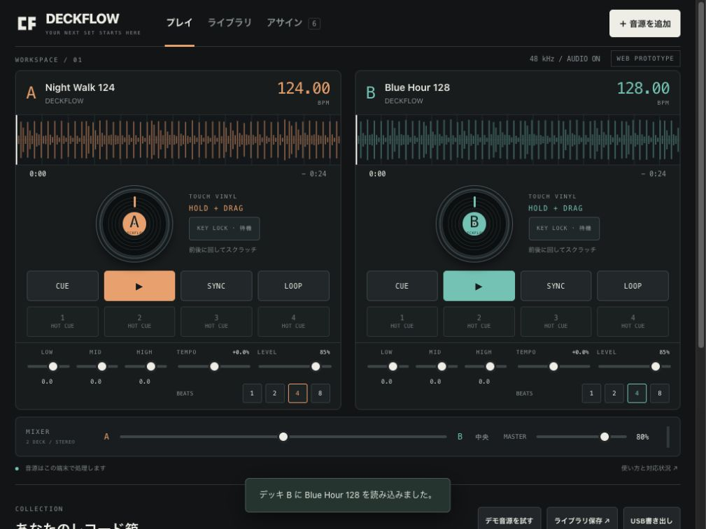

# v0.1 検証記録

実施日: **2026-11-06（JST）**。開発用の合成音源／一時出力フォルダだけを使い、既存のrekordboxライブラリやUSBメディアは変更していません。

## 自動チェック

```sh
DECKFLOW_BAKEN_BIN="$PWD/.local/baken/bin/baken" npm test
npm run build
```

**52件成功、失敗0、スキップ0**。ローカルNode.js 21.6.2で実行。CIはNode.js 22を指定しています。通常の`npm test`でbakenが見つからない場合、実writerの1件はスキップとなります。今回の52件は実writerを明示して実行しています。

| 範囲 | 確認内容 |
| --- | --- |
| BPM | 90／120／128／174 BPMの合成拍、背景ノイズ、無音、定常音、短尺、無音イントロ、不正入力 |
| KEY LOCK | 実際のSoundTouch DSPで440／660 Hzを処理。速度0.92／1.08／1.25で音程維持を確認 |
| スクラッチDSP | PCMの正転／逆転、分数位置、停止時無音、終端、dispose |
| Transport | rate変更、pause、seek、CUE、loop、scratch中の新曲load、準備前release等の競合 |
| 保存 | メタデータと音源の分離、quotaエラー、初期memory fallbackの明示、参照整合性、JSON検証 |
| アサイン | Note-Off、velocity zero、CC edge、Pitch Bend、相対値、修飾キー、入力中の抑止、競合・保存・hotplug |
| HOT CUE更新 | 同一曲の同時保存、保存失敗からの復帰、削除と遅延書き込みの順序 |
| USB | 固定版bakenを実行。PDB／ANLZ、BPM、先頭拍、HOT CUE、プレイリスト順、音源SHA-256を読み戻し |

静的buildは構文を確認し、実行資産17ファイル・約232 KiBをオフラインキャッシュに登録します。対応ソースとライセンスは別途配布物に含みます。追加のnpmランタイム依存はありません。

## ブラウザでの確認

Codexのin-app browserで実際のUIを操作しました。

- 2曲のデモ生成・BPM解析（124.00／128.00）、曲のA／B読み込み。
- 再生、停止、4拍ループ、相手デッキへのBPM同期。
- プラッターのドラッグ後、元の再生状態へ復帰。逆再生の音声内容自体は上記DSPテストで確認。
- 相対エンコーダーの選択状態でもキーLearnが動作。割り当てを保存。
- プレイリスト作成、曲の追加、再読み込み後の音源・プレイリスト・割り当ての保持。
- ネイティブpromptに依存せず、HTML dialogでプレイリスト作成・確認を実行。
- 1024×768、768×1024、390×844で横方向のはみ出しを確認し、狭い画面の検索欄を修正。
- 1024×768の横向きではデッキとミキサーを一画面に配置。
- **開発HTTPサーバーを停止**して接続できないことを確認後、Service Workerから再読み込み。保存曲を再生し、KEY LOCKの有効状態まで確認。

一時的なブラウザのviewport変更と、開発時のService Worker bypassは検証終了時に解除します。ユーザーのネットワーク設定や他のアプリの音声設定は変更していません。



## iPadシミュレーター

- Xcode 27.2、deployment target iOS 17.0、Simulator向けarm64／x86_64の署名なしbuild成功。
- iPad mini（A17 Pro）／iOS 27.0の専用Simulatorで **3テスト成功、失敗・スキップ0**。
- localhostのsecure context、実際のapp.jsによるプラッター／アサインUI生成、同梱SoundTouchの取得・Worklet登録・ノード構築を確認。
- Web MIDI互換shimからWKブリッジを通してCoreMIDIを明示的に開始し、入力Mapが返るところまで確認。
- サーバーのパス制限、MIDI running status／分割入力を確認。
- 最新の`dist/`を再同期してbuild。アプリの同梱Webは生成物としてGitから除外し、同期スクリプトを収録。
- 今回作成した専用Simulatorだけを終了・削除。既存Simulatorは変更していません。

JSONのnative保存・共有はソース確認までです。実機での保存ダイアログ、共有先、外付けストレージへの移動は受け入れ確認に含めてください。

## 残る実機確認

この検証は、次の項目を完了したことにはなりません。

1. 物理iPad mini 8での音質、スクラッチ追従、音声遅延、発熱、メモリ、長時間運転。
2. 実コントローラーのMIDI接続、抜き差し、給電、ジョグの相対値方式、全操作のマッピング。
3. ヘッドホンCUEとマスターの独立出力。現時点で未実装。
4. iPad単体でのCDJ用USB生成。現時点で未実装。
5. USB実媒体のファイルシステム／配置と、CDJ-3000での曲一覧、再生、波形、HOT CUE、Quantize。
6. 実曲コーパスでのBPM／先頭拍の精度、可変テンポ対応。

本番のDJセットで使う前に、テスト用音源と別のUSBで確認してください。

## 2026-11-07: 可変レイアウト・音源ドロップ・管理画面の初期表示

- アプリの最大幅1680pxを撤廃。左右12〜24px（safe areaを除く）を残して全幅を使用。
- 2560×1440、1920×1080、1440×900、1024×768、768×1024、390×844で表示幅を確認。1024×768ではミキサーまで画面内に収まり、停止中の波形もリサイズ後の実寸へ追従。
- 初期表示と再読み込み後の表示を楽曲管理・解析に変更。DJプレイとの切り替え・曲のデッキ読み込みをブラウザで確認。
- ファイルドラッグの判定、複数ファイル、フォルダ除外、子要素への移動、キャンセル時の表示解除、通常ドラッグの非干渉を5件の自動テストで確認。
- ブラウザのファイル選択で合成WAVとテキストファイルを同時指定し、WAVの120 BPM解析・保存と非音源のエラー表示を確認。OSからの実ドラッグ操作と物理iPadの「ファイル」アプリからのドラッグは未確認。
- 全体テスト **57件成功、失敗0、スキップ0**（実bakenを指定）。buildとiPad向けWeb資産同期が成功。今回、native Simulatorの再実行はしていません。

## 2026-11-07: 楽曲管理からの試聴・BPM・EQ

- 楽曲一覧の▶で再生／一時停止。試聴バーから停止（先頭へ戻す）・シーク・別曲への切り替えを確認。検索で試聴中の曲を一覧から隠しても、バーから停止可能。
- 再生BPMの直接入力（124→130、128→132）とテンポ表示、LOW／MID／HIGHの操作、別曲へ切り替えた際の初期値復帰をブラウザで確認。再生BPMは音程と連動し、保存済みの解析BPMを変更しない。
- 「解析BPMを修正」から既存の曲情報編集を開き、保存後の表示更新を確認。試聴のEQ／テンポは音源ファイルには書き込まない。
- DJプレイへの移動で試聴を停止。DJデッキの再生中は試聴を開始せず案内する。スクラッチの準備・復帰中も排他対象とする。
- 1440px、1024px、390px幅で試聴バーの配置と横方向のはみ出しがないことを確認。
- 試聴専用12テストで停止・曲切替・削除相当clearと非同期decodeの競合、古い終了イベント、速度変更時の再生位置、EQ値とノード接続、音量後のlimiter、エラーからの復帰を確認。
- 全体テスト **69件成功、失敗0、スキップ0**（実bakenを指定）。Web build・iPad同梱資産同期を実施。物理iPadでの音声遅延、EQの聴感、背景化／割り込みからの復帰は未検証。今回native Simulatorの再実行はしていません。

## 2026-11-07: rekordbox XML・既存ANLZの引き継ぎ

- 全体テスト **86件成功、失敗0、スキップ0**。固定版bakenを明示指定。Web build成功（22実行資産、約292 KiB）、iPadへ54ファイルのWeb資産同期を実施。
- XMLのUnicode・文字参照、可変TEMPO、HOT CUE A〜H、メモリーCUE、名前・色付きLOOP、階層プレイリスト、Location参照、整数秒曲長の末尾マーカーを検証。DTD・外部エンティティ・不正な数値・参照・重複・未対応マーカーを拒否。
- 保存はトランザクション内で参照を検証して追加。既存IDの編集内容・音源を保持し、再取り込みと別XMLの同名プレイリストを検証。
- 音源の関連付けはBPM解析を通らず、表示用ピークだけを計算。曖昧な同名候補、異なるサイズ／曲長、実音源を超えるマーカーを拒否。実長更新後もテンポ・CUE・LOOPを保持。
- 実bakenでDAT／EXT／2EXを生成し、波形のバイト列を意図的に変えた既存ANLZからの再書き出しで、その波形・PQTZ／PQT2のSHA-256一致と原本ファイルの不変を確認。2EXのない旧形式、フルパス不一致時の再生成、明示マップ、曖昧なキャッシュ、可変TEMPO不一致を確認。
- CUE位置だけでなく、件数、ループ終端、名前、端末パレット色を読み戻して照合。削除後に残存したCUE・色消失・不正な末尾ビートを検知する回帰テストを追加。
- ブラウザUIから合成XMLとWAVを選択し、1曲・階層プレイリストの追加、音源関連付け、曲情報の表示、編集後のXML再取り込みで編集と音源が残ること、ページ再読み込み後の保存を確認。WebからダウンロードしたJSONも検証し、TEMPO／HOT LOOP H／RGB／階層／表示波形を確認。
- DJデッキで取り込んだHOT LOOP Hを再生し、ループONと現在区間の90 BPM表示を確認。可変テンポの区間をまたぐ拍数ループとグリッド表示は単体テストでも確認。管理画面では試聴欄を「再生BPM（平均）」と表示。
- 390／1024／1440px幅で横方向のはみ出しがないことを確認。1024pxのHOT CUEは4列×2段・高さ44px、ミキサーまで画面内に配置。試聴とデッキは停止して検証終了、viewportを解除。
- 元のrekordboxライブラリ・音源・USB媒体は変更していません。今回native Simulatorは再実行していません。物理iPad、実ユーザーの大規模XML、CDJ-3000実機での音出し・波形・Quantizeは未検証です。

## 2026-11-07: 楽曲管理画面のデザイン整理

- 空状態では検索・表・書き出し操作を隠し、音源追加を主操作として配置。XML／デモの代替導線を分け、重複する説明を整理。
- 曲があるときは「ライブラリ操作」メニューへ補助操作を集約。外側クリック・操作選択・Escapeで閉じ、Escape後のフォーカスをsummaryへ戻す。
- モバイルの曲一覧を2段表示にし、曲名・試聴・BPMを優先。試聴・デッキ読み込み・曲操作は44px以上の領域を確保。
- ブラウザで空状態のXMLダイアログ、デモ追加による2曲の保存と一覧への切替、USB案内のメニュー起動、検索結果なし、試聴開始・停止を確認。390px・1024px・1280pxで表示を確認し、横方向のはみ出しがないことを測定。
- 新旧の同じモバイル幅のスクリーンショットを比較。新規音源追加ボタンが画面上部へ近づき、空の表・二重見出しが消えたことを確認。音声を停止し、viewport変更を解除。
- 今後の開発対象はWeb／PWA。以前のnative/iosは検証用として保持し、今回のWeb画面修正では同期・native buildを実行していません。

## 2026-11-07 — 既存ライブラリ・USB取り込み／キャッシュ／ライブラリUI

- `DECKFLOW_BAKEN_BIN="$PWD/.local/baken/bin/baken" npm test`: **134 passed, 0 failed, 0 skipped**。固定bakenの実行を含む。master.db／OneLibraryの独立したSQLCipher合成fixture、改ざんHMAC、SQLite overflow／循環／文字列、削除済みDB行、master CUE A〜H／メモリーループ、PDB／ANLZ、同名音源の逆引き衝突、中止・再開、DAT後のEXT追加、編集保護、容量不足、共有PCMの再利用／上限／キャンセルを確認。
- `npm run build`: **31 runtime assets, 410 KiB**、offline cache `295243c4786709c0`。`git diff --check` passed。
- in-app Chromiumの別ローカルoriginで、合成の `master.db`、`exportLibrary.db`、従来 `export.pdb` をフォルダ選択から取り込み。音源コピー、一覧表示、試聴、DJデッキへの読み込みを確認。ユーザーの実ライブラリは参照していない。
- 従来USB fixtureから2テンポ区間、メモリーループ、HOT H、既存波形を引き継いだ。master fixtureではmemory 0.5秒、active memory loop 2〜4秒、Hot A 1秒、Hot H loop 6〜7.5秒を曲情報で確認。解析ファイルを選ばない場合の警告も確認。
- 同じOneLibraryを再取り込みして「0曲を追加・音源コピー0曲・1曲はキャッシュ・DB解析結果もキャッシュ」を確認。ページ再読み込み後、フォルダ再選択なしで保存済みUSB音源を試聴できた。
- 80曲の合成XMLをWorker経由で取り込み、最初75行／次5行、2ページ目から検索すると1行へ絞り込めることを確認。実運用規模の速度ベンチマークではない。
- 左ナビ／中央一覧／下部試聴バー、試聴BPM120→126（+5%）、テンポ・EQパネルを確認。1280／1024／390 CSS pxでdocumentの横はみ出しなし。390pxで試聴・A/B・詳細ボタンは44×44px。ブラウザのviewport／device metricsは終了時に解除。console error/warnは確認範囲で0件。
- 画面記録: `docs/library-preview.png`（合成データ）。UI部品の参照元は `docs/OSS_REVIEW.md`。React等のUI依存追加なし。
- 物理iPadでのUSBファイル選択・Safari・音声遅延・長時間安定性、実rekordboxの全DBバージョン、CDJ-3000の実機検証は未実施。USB挿入の自動検知はせず、ユーザーがフォルダを選ぶ。保存済み項目を上書きする同期ではなく追加取り込みで、元DB／USBは変更しない。

## 2026-11-07 — 黒ベース・赤アクセント・フラットな選択表示

- 背景・パネルを無彩色の黒／グレーに統一。主操作・選択ライン・デッキA・PWAアイコンのアクセントを赤へ変更。
- 読み込み元とプレイリストの選択は、濃いグレーの面と四辺同じ太さ（2px）の赤い輪郭線で表示。ボタン・入力欄・パネル・ダイアログを含め角丸をなくし、内側の影を取り除いた。プラッターとレコードの円形は保持。飾りのコピー、重複する見出し、バッジも整理。
- Chromiumで合成ライブラリの一覧・試聴の開始／一時停止・初期画面・読み込みダイアログを確認。選択項目の計算済みスタイルは角丸0px、影なし、背景rgb(34,34,34)、輪郭線rgb(239,83,91)。
- 390／1024 CSS pxでdocumentの横はみ出しなし。390pxの試聴ボタンは44×44px。表示幅のエミュレーションを解除し、停止中の一覧を `docs/library-preview.png` に記録。
- `npm run build` 成功（31 runtime assets、412 KiB、offline cache `38bb4c2305687e9a`）。`git diff --check` 成功。表示のみの変更で、音声・取り込み・保存処理は変更していない。物理iPadでの確認は未実施。

## 2026-11-07 — 精細波形・大型プラッター・Docker／Vercel

- 全体波形と2／4／8／16／32秒の拡大波形、位置追従、拍／小節／HOT CUE／ループ表示を追加。全体と拡大のシーク座標を分離し、一覧は55本の棒からCanvasへ変更。管理画面の試聴波形は曲全体を表示し、終端へ直接移動できる。
- 読み込み済みPCMを再デコードせずWorkerへ最大1 MiBのチャンクで渡し、通常150 frame/sの正負ピークと3帯域を生成。左右逆相を相殺せず、短いピークと末尾も保持。30万frame上限を超える長尺では実時間範囲を保って密度を下げる。BPM／CUE／既存ANLZは変更しない。
- RAM16 MiB／8件、独立IndexedDB32 MiB／128件のLRUキャッシュ。音源変更・削除・pagehide後の遅延結果を無効化。保存失敗時はRAMと従来波形を利用し、再生は継続。
- 全体テスト **172 passed、0 failed、0 skipped**（固定bakenを含む）。ピーク保持、逆相、帯域、可変テンポ、長尺での拍位相、縮小集約、同入力の描画省略、Worker／保存失敗、キャッシュ無効化を検証。
- 実Chromiumの隔離originで逆相4秒音源を生成し600frame、初回generated=1、キャッシュインスタンス破棄後persistentHits=1／generated=0を確認。検証キーは終了時に削除。
- UIでデモ2曲の詳細波形、8→4秒ズーム、キーボードシーク、再生／停止、プラッターのドラッグ後の位置変更を確認。管理画面では24秒の終端へのシークと停止を確認。console error/warnなし。1280／1024／390 CSS pxで横はみ出しなし。プラッター径は1024幅で256px、390幅で273px。
- ボタン・入力欄・パネルは直角、黒ベース・赤アクセント。選択は四辺2pxの赤枠。プラッター操作の説明文を除去。色付き波形も赤／灰／白に限定。
- 配信先で新旧のCSS／JSが混在する事象を確認したため、CSS／アイコンの内容hashに加え、全JavaScript・dynamic import・Worker・Workletを共通graph hashで参照。2回buildの再現性、依存のみの更新伝播、参照欠落時の書き換え防止を5テストで検証。最終build:35 runtime assets／452 KiB、cache `ae8de3133c0e1493`。
- Dockerは最新コードを隔離Compose projectでbuild／起動しhealthy、uid101、read-onlyを確認。69のprecache URLと30 JS／40依存参照、波形Worker、MIME、cache header、404、nginx -tが成功。検証コンテナとnetworkはdown済み。
- Vercel用にbuildCommand/outputDirectory/headersを設定しREADMEへ手順を追加。Vercelへの実デプロイは行っていない。
- 物理iPad／Safariでの音声遅延・長時間安定性は未検証。帯域分離は表示用で、rekordbox内部の解析アルゴリズムを再現するものではない。
