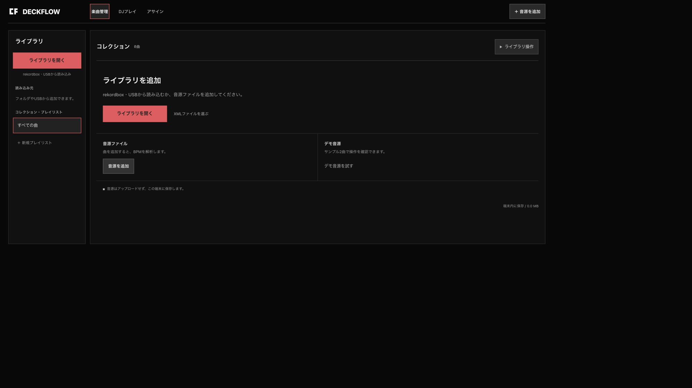
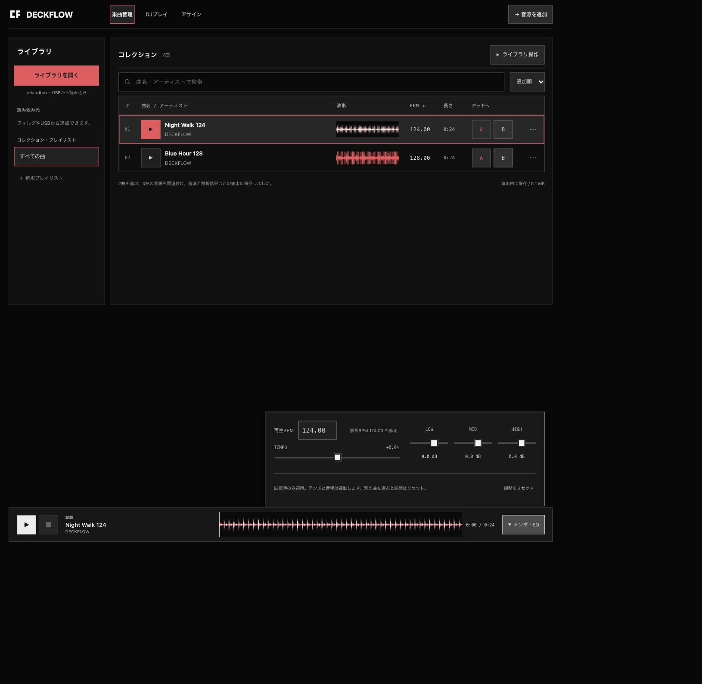
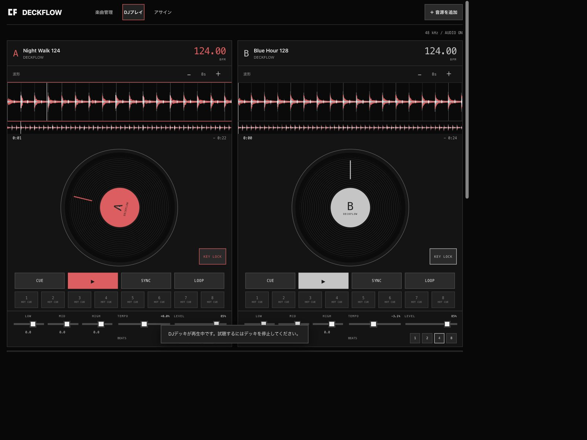
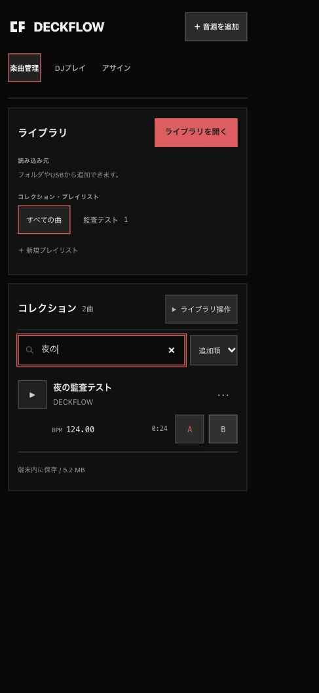
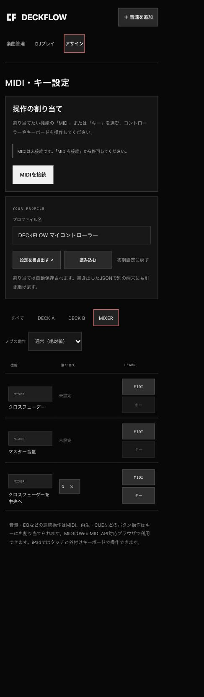

# DECKFLOW 包括監査・修正報告（2026-11-07）

## A. 監査範囲と実施状況

開始コミットは `ba8650edd903dc74b5cbd2388f663c5161beaec2`、開始時は `main`・変更なし。作業ブランチは `codex/audit-20261107`。本報告は監査完了時点の記録で、その時点では未コミット・未反映だった。後続のpush・本番反映は別途承認され、Git履歴とVercelのdeploymentに記録する。

macOS 27.2 / arm64、Node 24.16.0、npm 11.13.0、Codex内蔵ブラウザの専用localhost originを使用。CI互換確認は隔離したNode 22.23.1コンテナで実施。USB検証は合成WAVと一時出力フォルダ、保存検証は専用ランダム名のIndexedDBのみ。利用者の実ライブラリ、実USB、本番データは使用していない。

期待動作の根拠はREADME、REKORDBOX_IMPORT、USB_EXPORT、既存の操作説明、および後述する公式資料。以前のVERIFICATIONに記載された実行結果は今回の検証結果と区別した。

### 構成・主要な操作

| 対象 | 確認した構成・操作 |
| --- | --- |
| 利用者と画面 | 端末ローカルの利用者。楽曲管理、DJプレイ、MIDI・キー設定、取り込み・編集・確認dialog。別の管理者画面、会社・組織境界、アカウントはない |
| 主要フロー | 音源選択→デコード→Worker解析→IndexedDB保存→試聴／デッキ読込→再生・CUE・ループ・SYNC。XML／DB→曲・プレイリスト保存→音源関連付け。JSON→Mac helper→新規USB用フォルダ |
| Web | HTML/CSS/ES Modules、Web Audio、Worker/AudioWorklet、Web MIDI、Pointer Events、Service Worker/PWA。`dist`が実装ソースも兼ねる |
| 保存 | IndexedDBの曲・音源・設定、独立した波形キャッシュ、localStorageの割り当て。RAM上のPCM／波形キャッシュ。保存不可時のMemory fallback |
| 配信・サーバー | 開発用Node静的サーバー、Docker nginx、Vercel静的配信設定。アプリ用のサーバーAPI・外部DB・キャッシュサーバーはない |
| 外部・非同期 | ブラウザ内Worker／Workletと資産取得。メール、通知配送、Webhook、cron、業務キュー、課金、AI APIはない |
| 補助ツール | Node USB helper、固定commitのbaken 4.10.0、SwiftUI/WKWebView/CoreMIDI/ローカル資産サーバーを含むiOSラッパー |
| 依存・品質 | npmランタイム依存なし。SoundTouchJS 2.1.1、固定版OneLibrary、baken。Node組み込みテスト、JS構文確認付きbuild、GitHub Actions、署名なしXcode build |

### 依頼項目ごとの判定

「指摘なし」はここに示した確認範囲だけの判定である。

| 観点 | 判定 | 確認内容・限界 |
| --- | --- | --- |
| ① セキュリティ | 確認した範囲では指摘なし | XMLエンティティ・非ローカルURL拒否、DB/ANLZ境界・サイズ検査、出力escape、USBパス・symlink拒否、shellを介さない引数渡し、native Host/Origin/main-frame制限、既知秘密情報形式をレビュー。公開システムへの試験は対象外 |
| 認証・会社別権限 | 対象外 | ログイン・セッション・SaaS組織・サーバーAPIが実装されていないため。認証不在を脆弱性とは判定していない |
| ② 機能 | 指摘あり | 逆相音源の解析、保存上限、KEY LOCK復帰、削除後状態を修正。登録・編集・検索・再生・XML取り込み・USB生成を確認 |
| ③ 整合性・同時実行 | 指摘あり | 曲編集と所属、プレイリスト作成、読み込み元登録、上限の原子的保存を修正。実IDB2接続で検証 |
| ④ API・外部・非同期 | 指摘あり | KEY LOCK初期化失敗の復帰を修正。Worker境界とキャンセル既存回帰を確認。実サービス配送・課金は実装なし |
| ⑤ UI/UX | 指摘あり | 削除後の読み込み元件数を修正。空状態、検索結果なし、保存、試聴排他、確認・キャンセル、キー学習を実操作 |
| ⑥ アクセシビリティ | 指摘あり／一部未確認 | 7dialogの読み上げ名を修正。DOM/AX、入力label、フォーカス、Escape、矢印キーを確認。網羅的な自動監査・VoiceOver・全コントラスト・200%拡大は未確認 |
| ⑦ 性能・容量 | 指摘あり／一部未確認 | 削除時にPCM/Worklet参照を解放。解析変換の前後計測、キャッシュ上限・ページ送りを確認。実機全体メモリ、音声遅延、同時利用目標は未確認 |
| ⑧ 障害・復旧 | 指摘あり／一部未確認 | 保存失敗rollback、音声fallback、配信停止中のPWA再起動を確認。端末データ消失からの完全復元は未確認・機能不足あり |
| ⑨ 運用・監視 | 確認した範囲では指摘なし／一部未確認 | ローカルエラー案内、Docker health・ログ設定、CIを確認。実運用の通知先・保持期間・監視稼働はリポジトリからは現時点ではわからない |
| ⑩ 端末・言語 | 確認した範囲では指摘なし／一部未確認 | 内蔵ブラウザで日本語文字列、再読込、1280×960と390×843 CSS px（実測）の横はみ出しなし。日本語IME変換中、実Safari/iPad、OSファイルアプリは未確認 |
| ⑪ 保守・依存 | 指摘あり | SoundTouchJSの来歴表示と実配布物の相違を修正。許諾表示を確認。推移依存全件・法的適合性全体は未確認 |
| ⑫ テスト・build・release | 確認した範囲では指摘なし | 追加回帰、全Nodeテスト、実IDB、最終Web/Docker/iOS buildを実施。リモートCI実行と本番リリースは対象外 |
| ⑬ 用途別 | 一部対象外／未確認 | SEOは単一公開アプリのtitle/lang/manifestを確認。検索公開方針・canonicalは要判断。音源は端末内処理。課金・AI・複数社SaaSは実装なし。データ保持・共有方針の法的適否は未確認 |

## B. 確認できた不具合と修正結果

重大度「中」は特定条件でデータ消失・部分保存・主要操作失敗を生じるもの、「低」は表示・補助情報の不整合。確認範囲で重大な権限突破や秘密漏えいは見つかっていないが、安全性全体を保証する判定ではない。

| ID・監査項目 | 問題・条件・影響／重大度 | 修正箇所・内容 | 検証結果・状態 |
| --- | --- | --- | --- |
| DF-01 ②③⑧ | 曲編集の保存後、プレイリスト追加が失敗すると曲名/BPMだけ残る。1つの保存操作が部分確定する／中 | [library-store.js](../dist/library-store.js#L362)、[app.js](../dist/app.js#L558)。最新データから曲編集と所属を同一transactionで確定 | Memory回帰と実IDB。成功、追加先消失、後半の容量エラー注入、曲・所属rollback、元音源保持を確認。修正済み |
| DF-02 ③ | 古い画面の一覧を全置換して新規プレイリストを作ると、別タブで先に作ったリストを消す／中 | [library-store.js](../dist/library-store.js#L383)、[app.js](../dist/app.js#L544)。transaction内の最新一覧へ追加。作成時の読み込み元filterも解除 | 2接続同時作成で両方のリストが残る。重複ID・不正参照は保存を変更せず拒否。修正済み |
| DF-03 ②③⑦ | 通常の音源追加は10,001曲目も保存し、READMEの上限とUSB用JSON検証が不整合／中 | [library-store.js](../dist/library-store.js#L341)。件数確認と新規保存を同一transactionで行う。既存曲編集は許可 | 9,999曲で2接続同時追加→1件だけ成功。拒否音源が残らず、上限時編集・削除後追加・10,000曲の書き出し検証も成功。修正済み |
| DF-04 ③④⑧ | 保存元20件時に21件目を取り込むと、参照保存失敗後も曲・リストが残る。再試行で別IDの孤立曲が増え得る／中 | [source-import.js](../dist/source-import.js#L61)、[library-store.js](../dist/library-store.js#L402)。参照・曲・リストを一括保存 | 上限拒否と参照保存の後半失敗を各2回試行し、曲・所属・参照が不変。既存参照の更新は成功。修正済み |
| DF-05 ②④⑧ | KEY LOCKノード生成/接続例外で再生が停止。READMEの通常再生fallbackと不一致／中 | [audio-engine.js](../dist/audio-engine.js#L287)。エラー時に部分ノードを解放し、現在位置・tempoでピッチ連動再生へ戻す | 生成・接続の失敗、復帰先接続、位置/tempo維持、後から再有効化を回帰確認。修正済み |
| DF-06 ②③ | MIDI学習で257件目を保存できるが、再起動の検証は256件超を拒否し全割り当てが初期化される／中 | [mappings.js](../dist/mappings.js#L220)。importと学習の上限を共通化し保存前に拒否 | 既存設定・保存文字列が不変、再起動で保持。256件で既存入力の置換は成功。修正済み |
| DF-07 ②⑦⑧ | デッキ読込曲を削除しても旧PCM・スクラッチコピー・曲長・loopが残り、空デッキの波形操作が旧曲に作用する／中 | [audio-engine.js](../dist/audio-engine.js#L232)、[app.js](../dist/app.js#L573)。unloadで再生要求取消・参照/位置/loop解放。空波形のキー操作を抑止 | 停止/再生/開始待ち/スクラッチ/準備待ちの5状態、遅延イベントで復活しないことをテスト。UI削除後に曲なし・長さ0・矢印操作後位置0を確認。修正済み |
| DF-08 ②⑦ | 左右が逆相のステレオ音源を平均すると全PCMが0となり、BPM不明・波形ゼロになる／中 | [analysis-input.js](../dist/analysis-input.js#L6)、[app.js](../dist/app.js#L328)。全区間エネルギー最大のchを選んで既存方式でdownsample | 120 BPM合成音源で修正前null→修正後120。mono/逆相/片ch無音/全無音/端数/不正入力を確認。再生音源のPCM自体は変更しない。修正済み |
| DF-09 ⑤ | 読み込み元の曲を削除しても一覧件数が削除前のまま残る／低 | [app.js](../dist/app.js#L424)。保存元snapshotと現在の曲IDの積集合を表示し、削除後に再描画 | 合成XML1曲を通常UIで取り込み→削除し、元一覧1→0、playlist1→0、collection3→2を確認。修正済み |
| DF-10 ⑥ | 7dialogに読み上げ用の名前がなく、DOM snapshotが名前なしdialogとなる／中 | [index.html](../dist/index.html#L94)。各見出しをaria-labelledbyで関連付け、確認文をaria-describedbyへ関連付け | 修正前の名前なしdialogを実操作で確認。修正後「曲の情報」「ライブラリを開く」「操作の確認」の名前をDOM/AXで確認、全7参照先の存在を確認。修正済み。全AA適合の判定ではない |
| DF-11 ⑪ | SoundTouchJSのmodified:false／原本のままという記載がbuildのimport query変更と不一致／低 | [provenance.json](../dist/vendor/soundtouchjs/provenance.json#L9)、[NOTICE.md](../dist/vendor/soundtouchjs/NOTICE.md#L7)、第三者表示。変更ファイル・方法を明記し原本SHAを保持 | 文書化したquery変更だけを除き、inventory全件のSHA一致を回帰確認。DSP本体は変更しない。修正済み |

重要なロジック変更は追加テストの失敗を確認してから修正した。実IndexedDBの失敗注入は合成データ・一時DBに限定し、元データが残ることまで検証した。dialogの属性と件数表示は、静的検査に加えて実UIで確認した。

## C. 改善提案（不具合とは別）

| 提案 | 目的・対象・期待効果 | 影響・条件 |
| --- | --- | --- |
| 復元可能なバックアップ | メタデータJSON再取込と元音源再関連付けを追加し、サイトデータ消失からの復旧を可能にする | 現在はJSON書出しだけ。衝突・上書き・ID/参照検証の仕様決定と復元テストが必要。今回新機能は追加していない |
| 複数タブの整合性方針 | HOT CUE/音源関連付けを含む全経路の競合検出、通知、再読込を設計する | 今回修正した原子的API以外の同時編集を一律保証しない。同一項目の競合時にどちらを残すか要判断 |
| 定常的なブラウザ回帰 | 追加した実IDB検証をCIに接続し、UI・Worker・オフライン・Safariの回帰を検知する | 現在のCIはNode test/build。実IDB fixtureは手動ブラウザ実行。CI用ブラウザ環境が必要 |
| a11yの残りの確認 | VoiceOver、色/contrast、200%拡大、各状態のfocusとタッチ領域を網羅する | WCAG 2.2 AA全体の評価と実機確認が必要。好みでの配色・レイアウト変更は今回実施していない |
| 実機の性能目標 | iPadでPCM総量、音声遅延、発熱、バックグラウンド復帰、長時間運転を測定する | 想定ライブラリ量・連続稼働時間・目標値が未指定。現時点で容量保証はできない |
| 配布再現性 | Docker imageのdigest固定と更新手順、推移依存の定期照合 | 固定すると更新運用が必要。今回の固定bakenと原本hash検証は維持 |
| データ管理の説明 | IndexedDBに元パス/曲情報を含むこと、JSON書出しの内容と消去範囲を整理 | 共有時の説明や保存期間は製品方針に依存。法令適合性は断定しない |

## D. 未確認・未解決事項と次の確認

| 未確認事項 | 理由／必要な情報・次の確認 |
| --- | --- |
| 物理iPad/Safari、MIDI、CDJ、USB | 対象機材での検証環境を使用していない。テスト用媒体/音源で接続、抜差し、再生、遅延、Quantize、CUEを確認する |
| native実行、署名、公証/配布 | 利用可能Simulator deviceは0。署名なしgeneric buildまで。対応runtime/deviceと配布設定を用意して実行テストする |
| IME変換中のキー、OSファイル選択 | 日本語文字列入力は確認、実IMEのcomposition経路やiPad「ファイル」は未確認。外付けキーボードと実OS pickerで確認する |
| 全操作の複数タブ同期 | 原子的保存の8ケースは検証したが、同一曲HOT CUE/音源再接続の全競合と画面自動更新は未確認。競合方針を定めた追加シナリオが必要 |
| ブラウザ強制終了・実quota枯渇 | 失敗注入によるrollbackを確認した。実容量枯渇、強制終了、OSストレージ退避を再現していない。専用端末/プロファイルで確認する |
| 完全なバックアップ復元 | JSON再取込は現状未実装。再起動時の保持やPWA再起動は、消失したデータの復元成功を意味しない |
| 性能・解析精度 | 合成音源の通常条件だけ。実曲コーパス、可変tempo精度、全体メモリ、限界負荷、目標値は現時点ではわからない |
| 本番設定・運用監視 | 今回は本番アクセス/変更対象外。Vercel実設定、通知配送、保持期間、実デプロイ/rollbackの成功は未確認 |
| 依存全体の脆弱性・法的適合性 | 公式公開ページと採用版を確認したが、Rust推移依存・OS image全パッケージは未照合。許諾/利用契約の最終判断は必要条件を整理して別途行う |
| プロジェクト全体の80% coverage | Nodeで計測されたruntimeファイルは80%を超えた。ただしapp.js、未ロードWorker、Swift、実ブラウザ部分は集計外であり、プロジェクト全体の80%達成は未確認 |

### リリースと復旧の準備

今回DB version/schema変更、環境変数追加、外部API互換性変更はない。`dist`には新しい解析入力moduleを含むため、個別JSのコピーではなく最終build一式を配布する。

1. 差分と下記テスト結果をレビューし、別途リリースが許可された時点でcommit/CIを実施する。監査段階ではpush・本番反映を行っていない。
2. `npm run build` を実行し、生成JS query、index、swを揃える。生成物の差分が追加で出ないことを確認する。iOS配布の場合は `npm run ios:sync` 後にbuildする。
3. 検証先で合成音源の追加→編集→試聴→デッキ、再起動・オフラインを確認する。演奏中のページは強制更新しない。
4. 不具合があれば以前のアプリcommitを別checkoutでbuildして静的配信を戻す。ローカルIndexedDBやユーザー音源を消去しない。Service Workerの更新待ちを考慮して再起動後の版を確認する。
5. コードrollbackは消えたユーザーデータの復元ではない。元音源/rekordboxの保管を継続し、サイトデータを消す前にJSONを書き出す。ただし現在そのJSONをUIで一括復元できない制限を説明する。

## E. 検証結果

| 検証 | 結果・条件 |
| --- | --- |
| 修正前 `npm test` | 199件中197成功、失敗0、baken未指定2skip。[開始時ログ](../docs/audit-2026-11-07/baseline-tests.txt#L1) |
| 最終Node 24全体 | 217成功、失敗0、skip0。固定baken実writerを含む。[結果](../docs/audit-2026-11-07/test-results.txt#L1) |
| Node 22互換 | v22.23.1、217件中215成功、失敗0、USB実writer2skip。networkなし・read-only・非rootのコンテナ。[結果](../docs/audit-2026-11-07/node22-tests.txt#L1) |
| Coverage | Nodeで計測したdist（vendor除外）の行81.40%、分岐82.73%、関数80.59%。未ロードファイルを含む全プロジェクト値ではない |
| 実IndexedDB | 8成功、失敗0。一時DB削除成功。[結果](../docs/audit-2026-11-07/indexeddb-results.txt#L1) |
| JS構文・build | 最終38 runtime assets、約476 KiB、graph `97faa0ed72231add`、SW cache `09586c34122f3937`。`git diff --check`成功 |
| USB | 9成功・skip0。合成WAV/PDB/ANLZ、CUE/playlist順、既存解析継承、音源SHA、元データ不変、既存出力拒否を確認。実媒体/CDJではない |
| Docker | 最終75 precache URL全件200・非空・ローカル最終bytes一致。MIME/nosniff/immutable/SW no-cache/health/404、uid101/read-only/cap_drop/no-new-privileges、nginx構文成功。検証container/networkは削除 |
| iOS | 最終72資産がdistとbytes一致。Xcode 27.2、署名なしgeneric iOS Simulator build成功、最終warning/errorなし。runtime実行なし |
| Browser | 合成デモ124/128 BPM、試聴/停止/tempo130、デッキ/ループ/SYNC、再生中試聴拒否、日本語編集/playlist/検索/再読込、合成XML取込/削除、削除後件数/空デッキ、キー学習キャンセル、dialog名を確認。確認中のconsole warn/errorなし |
| オフライン | 最終資産取得後に専用HTTPサーバーを停止し、curl接続拒否を確認。その状態でreload→保存曲読込→再生表示・位置進行を確認。HTMLのapp graphが最終版と一致。最後に再生停止、検証タブ/サーバーを終了 |
| 計測 | 60秒/48kHz/stereo合成PCM、Node24、各1回warmup後5回中央値。解析入力変換9.66→10.75 ms、出力5,760,000 bytesで同一。逆相修正による追加コストで、性能改善の主張ではない |

### 再検証コマンド

```sh
DECKFLOW_BAKEN_BIN="$PWD/.local/baken/bin/baken" npm test
npm run build
node scripts/serve-tests.mjs
```

最後のコマンドで表示されるlocalhostの検証ページを開き「検証を実行」を押す。専用ランダムDBだけを使い、終了時に削除する。`npm test`だけではこの8項目は実行されない。監査後はこの検証サーバーも停止済み。

### UI操作記録

今回取得した画面のみ掲載する。画面確認は音質・実機のタッチ追従・WCAG全体適合を証明しない。

1. **空ライブラリ→デモ追加：良好。** 追加方法、端末内保存の説明を表示し、2曲の解析・保存が完了。



2. **試聴→停止→テンポ調整：良好。** 再生状態が表示され、停止で先頭に戻り、保存済みBPMとは独立して130 BPMへ調整できた。



3. **2デッキ→再生/loop/SYNC：良好。** BがAの124 BPMへ同期。再生中の試聴を拒否し、矢印キーの波形移動も動作。



4. **曲編集→playlist→日本語検索：修正後良好。** 曲と所属を保存し、再読込後も保持。390 CSS pxでページ横はみ出しなし。dialogの読み上げ名を修正。



5. **アサイン→キー学習→キャンセル：良好。** 学習待ちを表示しEscapeで取消。実MIDI接続は行っていない。



### 参照した公式資料

- dialogの名前付けの根拠：[W3C Dialog Modal Pattern](https://www.w3.org/WAI/ARIA/apg/patterns/dialog-modal/)、[WCAG 2.2](https://www.w3.org/TR/WCAG22/)。今回の修正は名前付けの範囲に限る。
- 公開securityページ：[SoundTouchJS](https://github.com/cutterbl/SoundTouchJS/security)、[baken](https://github.com/M-Igashi/baken/security)、[OneLibrary](https://github.com/v1vendi/onelibrary/security)。取得ページ上に公開advisoryはなかったが、脆弱性不存在を意味しない。
- 採用版・許諾の根拠：[SoundTouchJS releases](https://github.com/cutterbl/SoundTouchJS/releases)、[MPL 2.0](https://www.mozilla.org/en-US/MPL/2.0/)。bakenは最新系列のみsecurity修正対象との方針だが、固定4.10.0の現時点のサポート状態は断定していない。
